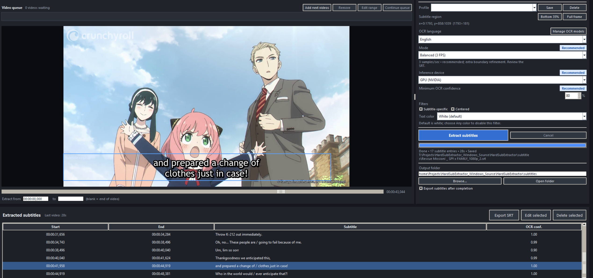
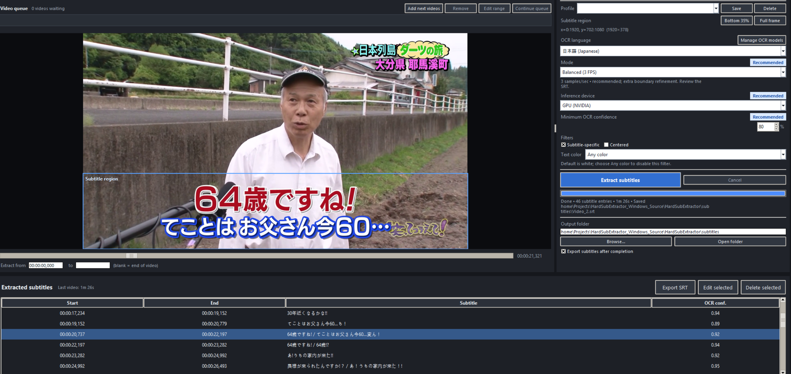

# HardSub Extractor

HardSub Extractor is a desktop app for turning subtitles burned into a video picture into an editable `.srt` draft. It samples video frames, reads visible text with OCR, groups repeated readings into timed cues, then lets the result be checked and saved.

It works on subtitle pixels. It does not transcribe speech from audio, read selectable subtitle tracks, translate dialogue, or erase subtitles from the video image. OCR can miss words or produce mistakes, so the SRT needs a review.

**Current app version:** `0.7.3`

## Download the app

The app is free to download from the [Ko-fi Shop](https://ko-fi.com/s/d468456083), [Patreon](https://www.patreon.com/ChumuDieKatze/posts/hardsubextractor-176361705), or [Payhip](https://payhip.com/b/aAZS8).

**System requirements:** For GPU inference, use an NVIDIA CUDA-compatible GPU with at least 4 GB VRAM (estimated minimum; 6–8 GB recommended). CPU inference is also available.

**Installation instructions:** See `INSTALL_FIRST.txt` inside the ZIP file.

This repository explains the app and its pipeline and includes a small command-line reference workflow. The desktop app source, executable, and installer packages are not included here.

## The desktop app

The app provides a visual workflow around the OCR pipeline:

- Load one video or build a queue of videos.
- Set the subtitle area to the bottom 35% or the full frame.
- Choose an OCR language, Fast or Balanced sampling, and CPU or NVIDIA GPU inference.
- Set minimum OCR confidence and filter by text color or horizontal position.
- Review extracted text and cue times, edit or delete SRT cues, and export the result.
- Set an output folder, export automatically when extraction finishes, and reopen that folder from the app.
- Download selected OCR models when needed and add more from the model manager later.
- Switch between dark and light themes and choose an interface language separately from the OCR language.

The app currently offers 18 OCR language choices: English, German, French, Spanish, Italian, Portuguese, Dutch, Japanese, Korean, Simplified Chinese, Traditional Chinese, Russian, Ukrainian, Indonesian, Malay, Filipino/Tagalog, Polish, and Swedish.

### English extraction example



The English OCR language is selected with Balanced mode, NVIDIA inference, 80% confidence, and centered white-text filters. The preview shows the subtitle region and the cue table from the completed run.

### Japanese extraction example



The Japanese OCR language is selected with Balanced mode and NVIDIA inference. The preview, selected subtitle region, and generated cue list are visible together.

Both screenshots come from real app runs on local sample videos. The video files are not included in this repository.

## What happens in an extraction

1. Open a video and choose the OCR language.
2. Keep the default bottom crop or switch to the full frame.
3. Choose a sampling mode and inference device, then set confidence and filters.
4. OCR runs on sampled image crops. The workflow groups similar readings into cues and estimates their start and end times.
5. Review the SRT in the cue list, edit any wording or timing that needs correction, then export.

Fast samples at 1 frame per second. Balanced samples at 3 frames per second and performs extra OCR checks near cue boundaries. A faster sample rate can help catch short subtitles, but it also adds inference work. OCR confidence is a model score, not a guarantee that the text is correct.

The desktop app uses Python with Tkinter for its interface, OpenCV for video frames and crops, PaddleOCR for text detection and recognition, and ONNX Runtime for CPU or NVIDIA CUDA inference. Models are downloaded separately from the app package when selected.

## Command-line example

The repository also contains a manually configured CLI workflow. It follows the same broad steps as the app, but it is a separate entry point; this is not the app’s full source tree.

The CLI can run the OCR pipeline without opening the desktop app. A recorded CPU run on the local English benchmark clip `en_015.mp4` used Balanced mode, 80% confidence, a bottom 35% crop, white text filtering, and centered-text filtering. It sampled 57 frames, found six cues, and wrote [`en_015-cli.srt`](examples/english/en_015-cli.srt) in 7.6 seconds after the OCR models were cached. All six text lines matched the clip labels, and the largest start/end difference was 0.034 seconds. This is one short controlled sample, not a real-world accuracy estimate.

The video file is not in this repository. To try the command, replace `path/to/your-video.mp4` with a local video:

```powershell
python workflow/video_to_srt.py --video "path/to/your-video.mp4" --language english --mode balanced --device cpu --region 0,0.65,1,1 --confidence 0.80 --color white --centered --output "output/sample.srt"
```

See [the CLI setup and options](workflow/README.md) for Python dependencies and the NVIDIA setup.

The CLI output includes this cue:

```srt
4
00:00:09,333 --> 00:00:11,917
The red door is on the left.
```

The matching reference cue ends at 11.933 seconds, 0.016 seconds later than this CLI boundary.

## Benchmarks

I ran controlled short-clip benchmarks for multiple languages and kept the reports under [`benchmarks/`](benchmarks/README.md). The clips used synthetic subtitles over a supplied video background, with variations in wording, font, size, outline, and color.

In the v0.6 benchmark, Balanced matched all 4,200 labeled cues across 14 tested languages. Both cue boundaries were within 0.1 seconds for 98.2% of cues; strict exact full-line text accuracy was 77.3%. The clips were short and low resolution, so those figures describe that test set only. They do not guarantee similar results on films, animation, streaming captures, or other fonts and encodings.

I plan to rerun the controlled set after meaningful pipeline updates and attach each report to its app version. The earlier v0.5 and v0.6 reports document the pipeline builds and test methods from those releases; they do not validate every later change.

## Repository map

| Path | Contents |
| --- | --- |
| [`workflow/`](workflow/README.md) | CLI workflow, setup steps, and options |
| [`workflow/MODELS.md`](workflow/MODELS.md) | OCR model families, language mapping, and upstream links |
| [`docs/APP_GUIDE.md`](docs/APP_GUIDE.md) | Desktop app workflow and feature notes |
| [`docs/PIPELINE.md`](docs/PIPELINE.md) | OCR and cue-building stages |
| [`sample_app_images/`](sample_app_images/README.md) | App screenshots from English and Japanese runs |
| [`examples/english/`](examples/english/) | SRT output from the CLI test run |
| [`benchmarks/`](benchmarks/README.md) | Versioned test reports and limitations |

Before sharing the repository publicly, confirm that the supplied test clip and screenshot are cleared for redistribution. The video files are intentionally not included.
