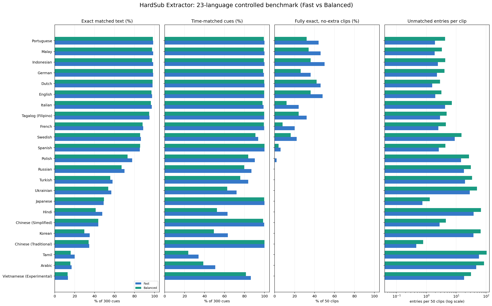

# HardSub Extractor v0.5.0 benchmark baseline

**App version tested:** `0.5.0` · **Git release tag:** `v0.5.0` · **Scope:** 23 OCR language options; 2,500 successful runs; 15,000 run-level cue instances.

This frozen report belongs to the first versioned app baseline. Results are not mixed with later application versions; new versions should receive their own report directory.

The [supplemental English scan-rate experiment](experiments/english-sampling-rate/README.md) compares 1, 3, and 6 FPS targets on the same English clips. It is a separate pipeline-setting experiment, not a replacement for the original mode comparison or a change to the v0.5.0 app release.

## Benchmark design

- 50 synthetic clips per language, six labelled subtitle cues per clip.
- 320×240 video at 15 FPS, about 18.93 seconds per clip; the same moving background was used throughout.
- Minimum OCR confidence 80%; subtitle-specific and centered filters enabled; bottom 35% subtitle region.
- RTX 4070; inference was configured for GPU, and the sessions reported CUDAExecutionProvider with CPU fallback. Startup also logged that no CUDA plugin EP device was found, and GPU utilization was not measured. Treat speed estimates as provisional.
- English, German, Simplified Chinese, and Japanese have historical Fast, Balanced, and Accurate runs. The other 19 language options were benchmarked in Fast and Balanced only. The pooled comparison below uses Fast and Balanced.

See the [dataset and curation guide](dataset/README.md), the [master analysis](MASTER_BENCHMARK_ANALYSIS.md), and [all per-language reports](results/README.md).

## Pooled results

Each mode covers 1,150 clips and 6,900 labelled cues. A time match means a unique extracted entry overlaps at least 30% of a reference cue; text and timing quality are scored separately.

| Measure | Fast | Balanced |
|---|---:|---:|
| Time-matched cues | 6,063/6,900 (87.9%) | 5,788/6,900 (83.9%) |
| Cues at least 95% text-similar | 5,210/6,900 (75.5%) | 5,018/6,900 (72.7%) |
| Exact matched text | 4,697/6,900 (68.1%) | 4,587/6,900 (66.5%) |
| Unmatched output entries | 15,835 | 28,074 |
| Clips with all six exact cues and no extras | 188/1,150 (16.3%) | 135/1,150 (11.7%) |
| Both cue boundaries within 0.1 seconds | 4,260/6,900 (61.7%) | 3,998/6,900 (57.9%) |
| Mean processing time per 18.93 s clip | 5.50 s | 10.31 s |
| Linear estimate for 1 hour of video | 17.4 min | 32.7 min |

All unmatched output entries overlapped a labelled subtitle interval in this synthetic set. That pattern is consistent with fragments or repeated readings during visible cues; overlap alone does not establish the cause. Fast led Balanced on the pooled measures above, but overall output still had substantial cue fragmentation and text errors.

## Interpretation and limits

The strict whole-clip cleanliness score is only 16.3% for Fast and 11.7% for Balanced. The benchmark therefore does **not** support a claim that the app captures 95% of complete, clean subtitle cues on real videos. Results use a single low-resolution synthetic background and a small, repeated phrase set; cues from the same source are not independent real-world samples. Vietnamese remains Experimental. Review each language report before making language-specific claims.

The one-hour estimates scale short-clip averages linearly, exclude model initialization/export, and may not reflect long videos. GPU activity was not sampled, so the observed times should not be described as confirmed GPU throughput. The benchmark calls the Python OCR backend directly; it does not measure packaged-EXE performance or UI behavior.

## Report contents

- `MASTER_BENCHMARK_ANALYSIS.md`: full cross-language interpretation and recommendations.
- `results/<language>/`: README, per-cue and per-run CSVs, summary CSV/JSON and charts for each option.
- `results/overall_*.csv` and `results/overall_language_comparison.png`: pooled and per-language summaries.
- `results/results.sqlite3`: sanitized structured case, curation and run database.
- `results/audit/predicted-srt.zip`: all extracted SRT outputs for audit.
- `results/audit/run-logs.zip`: benchmark logs with workstation-specific paths redacted.
- `dataset/`: portable curation metadata and case manifest; generated video files and the original source video are not included.
