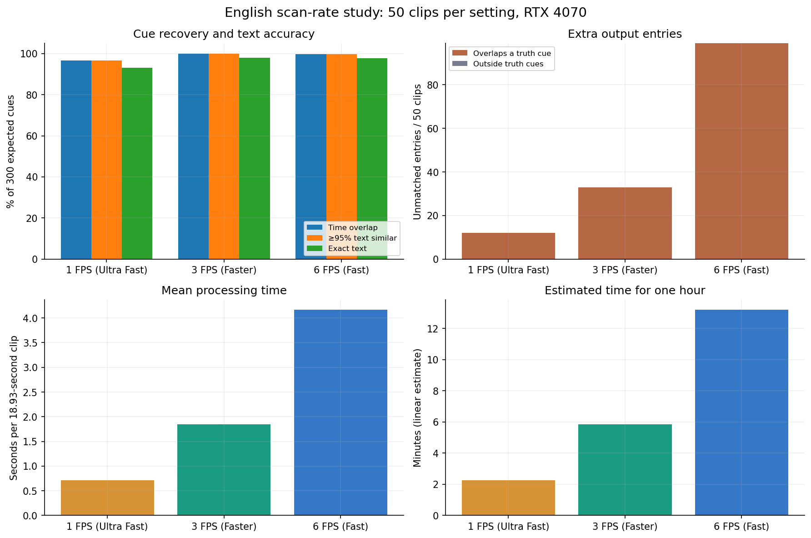

# English scan-rate experiment

This supplemental experiment tests how often the v0.5.0 extractor should sample frames for English subtitles. It is tied to the v0.5.0 app source, but is separate from the original Fast/Balanced/Accurate report. It does not change the app or its released settings.

**Run date:** 2026-11-16.

## Test setup

- 50 English clips, six labelled cues per clip (300 expected cues for each setting).
- Same 320×240, 15 FPS, 18.93-second source and benchmark dataset used in the v0.5.0 English tests.
- Compared target rates: 1 FPS (**Ultra Fast**), 3 FPS (**Faster**), and 6 FPS (**Fast**).
- Only the Fast configuration’s `sample_fps` value changed. Minimum OCR confidence stayed at 80%; subtitle-specific and centered filters stayed on; subtitle region stayed at the bottom 35%.
- PP-OCRv6 English model, PaddleOCR 3.7.0, PaddleX 3.7.2, ONNX Runtime GPU 1.30.0; inference configured for an NVIDIA RTX 4070 with 12 GB VRAM.
- The sessions listed CUDAExecutionProvider with CPU fallback, but startup warned that no CUDA plugin EP device was found. GPU utilization was not measured, so processing times are provisional and should not be presented as verified GPU throughput.

The extractor chooses an integer frame step using `max(1, floor(video_fps / target_fps))`. Consequently, on this 15 FPS source, the 6 FPS target sampled every two frames, or about **7.5 FPS**. It is the same effective sampling as the app’s current Fast configuration. The new 1 FPS and 3 FPS settings sampled at about 1.00 and 3.01 FPS.

## Results

| Setting | Actual scan rate | Samples / clip | Cues time-matched | Exact text | Unmatched outputs | Fully exact clips, no extras | Median start / end error | Both boundaries within 0.1 s | Mean time / clip | Estimate / hour |
|---|---:|---:|---:|---:|---:|---:|---:|---:|---:|---:|
| 1 FPS · Ultra Fast | 1.00 FPS | 19 | 290/300 (96.7%) | 279/300 (93.0%) | 12 | 28/50 | 0.667 / 0.400 s | 0/300 | 0.71 s | 2.3 min |
| 3 FPS · Faster | 3.01 FPS | 57 | 300/300 (100%) | 294/300 (98.0%) | 33 | 34/50 | 0.200 / 0.133 s | 36/300 (12.0%) | 1.84 s | 5.8 min |
| 6 FPS · Fast | 7.50 FPS | 142 | 299/300 (99.7%) | 293/300 (97.7%) | 99 | 24/50 | 0.000 / 0.067 s | 267/300 (89.0%) | 4.17 s | 13.2 min |

Text accuracy uses a strict exact match on a time-matched output. A cue counts as time-matched when one unique output overlaps at least 30% of the labelled cue. Timing errors are calculated only for matched cues. The clean-clip count requires all six cues to be exact and no unmatched output entries.

## Findings

- **3 FPS was the best overall tradeoff on this dataset.** It matched all 300 cues, had the most exact text matches (294), and produced the most fully exact clips without extras (34/50). Mean processing time was about 2.3× faster than the current 6 FPS target.
- **6 FPS gave the tightest typical timing.** Its median absolute start and end errors were 0 and 0.067 seconds; 89% of expected cues had both boundaries within 0.1 seconds. However, it emitted 99 unmatched entries, triple the 3 FPS count, and only 24/50 clips were fully exact with no extras.
- **1 FPS was fastest**, with a mean of 0.71 seconds per 18.93-second clip, but it missed 10 of 300 cues and had much coarser timing. Its one-hour estimate is about 2.3 minutes under this short-clip linear extrapolation.
- The 6 FPS run produced exactly the same output and cue matches as the original English Fast run. The experiment therefore validates the 1 and 3 FPS alternatives against the current Fast behavior.
- The 40% character error rate at 6 FPS is driven in large part by unmatched fragments being counted as inserted text. It does not mean that 40% of matched cue text was misrecognized.

**Recommendation for follow-up:** keep 3 FPS as the strongest candidate for a faster general-purpose setting, and retain 6 FPS where precise timing matters more than a clean first-pass SRT. Consider fractional-time sampling if the app is expected to deliver exactly 6 sampled frames per second; the current integer-step calculation oversamples this 15 FPS source at 7.5 FPS. Validate any chosen default on varied real-world videos before changing a release setting. This synthetic set is useful for controlled comparisons, not a real-world accuracy guarantee.

## Artifacts

- [Detailed report and figures](report/README.md)
- [Aggregate results by setting](report/summary_by_mode.csv)
- [Per-clip timing and accuracy data](report/per_run.csv)
- [Per-cue text and timing data](report/per_cue.csv)
- [Unmatched output entries](report/extra_entries.csv)
- [Underlying SQLite run data](results.sqlite3)
- [Study configuration](study_config.json)

The clips and runner are not included. This folder keeps the result tables, figures, database, and configuration from the earlier run. See the [v0.5.0 benchmark guide](../../README.md) for the test design and limitations.
