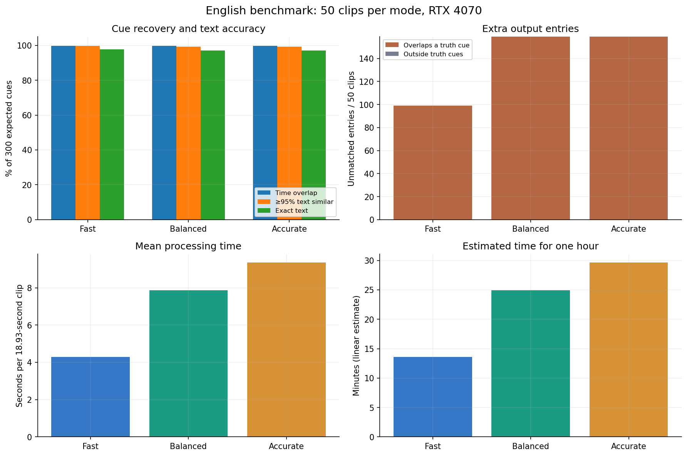
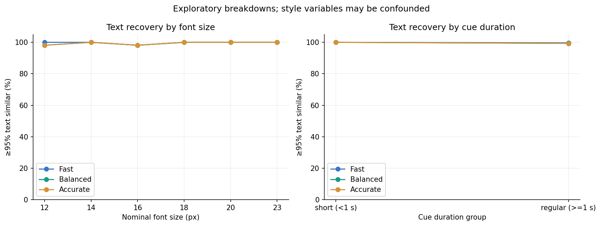
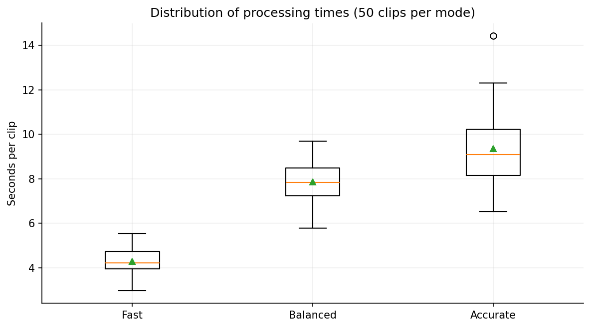

# English OCR benchmark

**App version under test:** `0.5.0` (release tag `v0.5.0`).

## Scope and setup

50 English clips × 3 modes = 150 successful extraction runs; six reference cues per clip (300 per mode). Source is a single 320×240, 15 FPS, 18.93-second video with synthetic burned-in subtitles. RTX 4070 12 GB; model detection and recognition sessions list CUDAExecutionProvider with CPU fallback. 80% minimum OCR confidence; subtitle-specific and centered filters enabled; bottom 35% region. White clips use the White filter; yellow/cyan clips use Any color. Model initialization is excluded from per-clip timings. The runner invokes the project’s Python OCR backend and extractor directly using its virtual environment; it does not automate the packaged EXE or UI. Models: PP-OCRv6 medium detection and recognition, PaddleOCR 3.7.0, PaddleX 3.7.2 and ONNX Runtime GPU 1.30.0. Source file SHA-256: 521bdee29db5c6fb316170948697f9a952b443b01397beacf8259e020d15385f.

## Results

| Mode | Time matched | ≥95% similar | Exact text | Extra entries | CER | Mean per clip | Estimate per hour |
|---|---:|---:|---:|---:|---:|---:|---:|
| Fast | 299/300 (99.7%) | 299/300 (99.7%) | 293/300 (97.7%) | 99 | 40.0% | 4.29 s | 13.6 min |
| Balanced | 299/300 (99.7%) | 298/300 (99.3%) | 291/300 (97.0%) | 159 | 63.5% | 7.86 s | 24.9 min |
| Accurate | 299/300 (99.7%) | 298/300 (99.3%) | 291/300 (97.0%) | 159 | 63.5% | 9.35 s | 29.6 min |

| Mode | Clips with all six exact and no extras | Median absolute start error | Median absolute end error | Both boundaries within 0.1 s | Exact text in cue time window |
|---|---:|---:|---:|---:|---:|
| Fast | 24/50 | 0.000 s | 0.067 s | 267/300 (89.0%) | 296/300 |
| Balanced | 18/50 | 0.000 s | 0.000 s | 255/300 (85.0%) | 296/300 |
| Accurate | 18/50 | 0.033 s | 0.033 s | 255/300 (85.0%) | 296/300 |

The six-exact/no-extras count does not require precise cue timing. Timing errors omit unmatched cues. Exact text in cue time checks whether the exact label appeared in any output entry during that cue, even if the one-to-one matcher selected a different entry.

Fast was the quickest mode and produced fewer unmatched entries on this dataset. Balanced and Accurate had the same aggregate text and extra-entry counts here, though their cue timings and processing times differ. A high cue recovery rate does not mean the exported SRT is clean: only 24 of 50 Fast clips and 18 of 50 clips in each other mode had all six exact and no extra entries. The high CER is driven substantially by counting all characters in unmatched fragments as insertions; it is not simply the per-character recognition error among successfully matched text.

All three modes failed the 30% single-entry time-overlap rule on cue 3 of `en_043`. The text was actually recognized in several shorter entries, including exact ones; the cue is counted as unmatched because no one entry spans enough of the reference cue. This is fragmentation, not evidence that the line was never read.

## Examples requiring review

- en_043, Fast, cue 3: expected "I can't believe it's already midnight. 143"; output (no qualifying single-entry time match; fragments may exist).
- en_043, Balanced, cue 3: expected "I can't believe it's already midnight. 143"; output (no qualifying single-entry time match; fragments may exist).
- en_043, Accurate, cue 3: expected "I can't believe it's already midnight. 143"; output (no qualifying single-entry time match; fragments may exist).
- en_002, Fast, cue 2: expected "Wait... are we really going?"; output "Wait... are we really going".
- en_003, Balanced, cue 4: expected "Wait... are we really going?"; output "Wait. are we really going?".
- en_003, Accurate, cue 4: expected "Wait... are we really going?"; output "Wait. are we really going?".

## Interpretation and definitions

- A time match requires at least 30% of the reference cue duration to overlap one unique output entry; text can still be wrong. Matches maximize the number of time-matched cues first, then text similarity. One output can match only one reference cue.
- Text similarity is 1 − Levenshtein distance / max(reference length, output length), after Unicode NFC and whitespace normalization. Case and punctuation count. The ≥95% and exact rates use all 300 reference cues as denominator, so missed cues count against both.
- Extra entries are outputs left unmatched after one-to-one matching. An extra overlapping a reference cue may be a fragment or duplicate; an extra outside reference timings may be a false positive. These timing categories alone do not prove the cause.
- Median absolute start and end timing errors and the mean overlap fraction for matched cues are available in the summary CSV. These timing figures omit unmatched cues; exact text does not imply exact timing.
- Character error rate (CER) counts edits in matched text, all characters of unmatched reference cues as deletions, and all characters of unmatched output entries as insertions, divided by the number of reference characters. It can exceed 100%.
- Timing estimates scale the mean measured extraction-plus-matching time linearly to 3,600 seconds, excluding model initialization and export. Each clip was run once per mode in fixed Fast, Balanced, Accurate order with a shared loaded model. Actual one-hour videos can differ substantially with resolution, frame rate, subtitle density, codec, hardware, warm-up and other workload.
- Style comparisons are exploratory: font, size, color, outline, cue text and timing are not randomized independently. Sample sizes vary; see the breakdown CSV. The 50 clips reuse the same background and seven base phrases, so these results are not a representative estimate or guarantee of real-world performance.
- Predicted SRT files preserve every extracted entry and can be compared with the matching dataset SRT. Timing is rounded to milliseconds for export. No manual review of all OCR errors was performed.

## Files

- `summary_by_mode.csv`: aggregate results, including min/median/max runtime and extra-entry breakdown.
- `per_run.csv`: timings, settings and counts for every clip and mode.
- `per_cue.csv`: expected text, matched output, similarity, timings and style for each reference cue.
- `extra_entries.csv`: every unmatched output with its time and text.
- `breakdown_by_style_and_duration.csv`: cue-level counts and rates by style, duration and mode.
- [Predicted SRT files for all runs](../audit/predicted-srt.zip).
- [Underlying structured run data](../results.sqlite3) and [sanitized benchmark logs](../audit/run-logs.zip).
