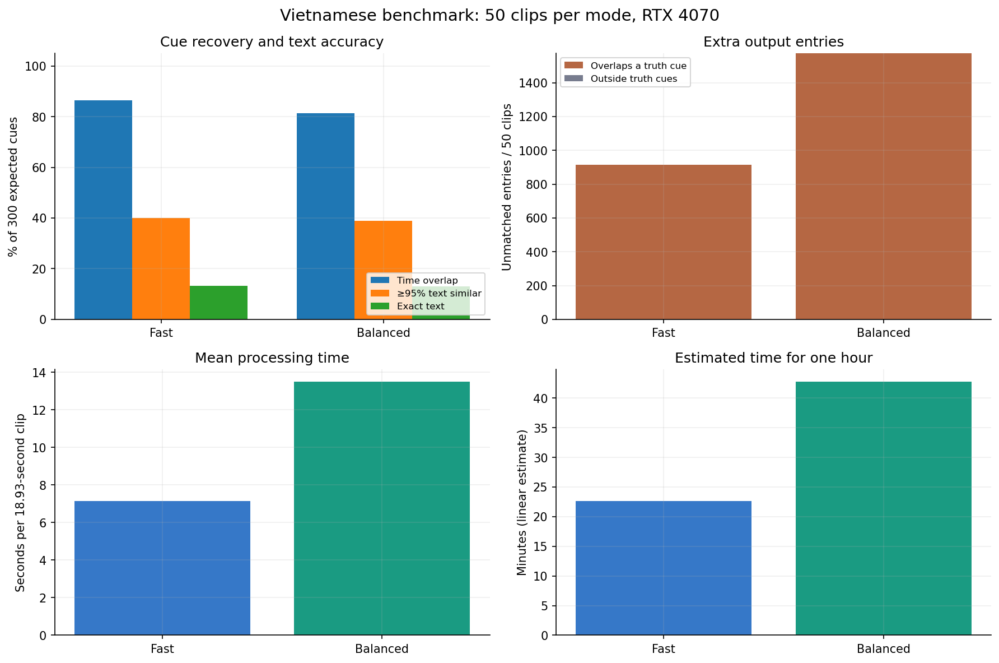
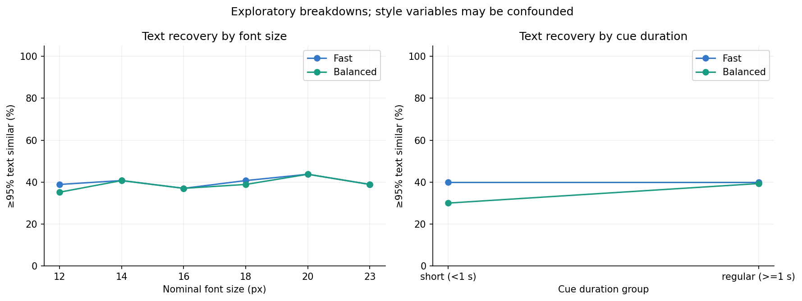
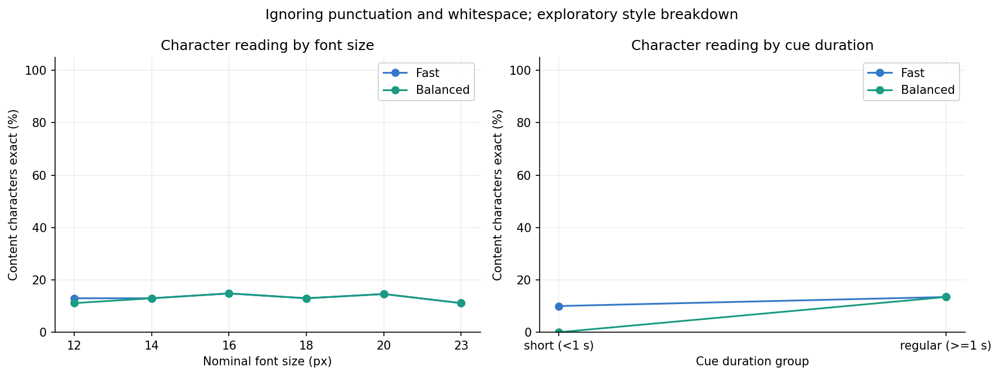
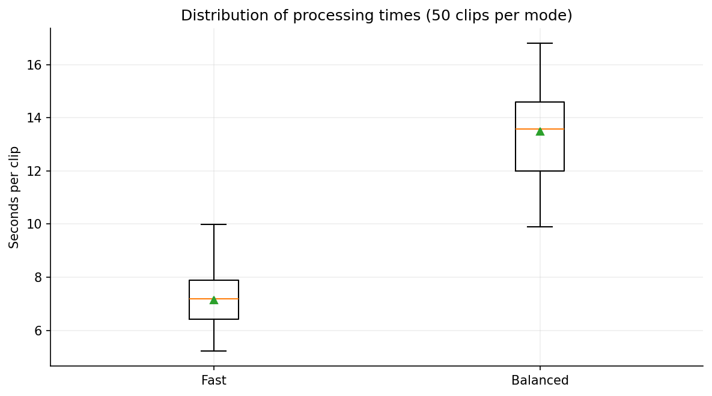

# Vietnamese OCR benchmark — Experimental

**App version under test:** `0.5.0` (release tag `v0.5.0`).

**Product status: Experimental.** The measured text accuracy and SRT cleanliness are not sufficient for reliable use.

## Scope and setup

50 Vietnamese clips × 2 modes = 100 successful extraction runs; 6 reference cues per clip (300 per mode). Source is a single 320×240, 15 FPS, 18.93-second video with synthetic burned-in subtitles. RTX 4070 12 GB; model detection and recognition sessions list CUDAExecutionProvider with CPU fallback. 80% minimum OCR confidence; subtitle-specific and centered filters enabled; bottom 35% region. White clips use the White filter; yellow/cyan clips use Any color. Model initialization is excluded from per-clip timings. The runner invokes the project’s Python OCR backend and extractor directly using its virtual environment; it does not automate the packaged EXE or UI. Model: PP-OCRv6; PaddleOCR 3.7.0, PaddleX 3.7.2 and ONNX Runtime GPU 1.30.0. Source file SHA-256: 521bdee29db5c6fb316170948697f9a952b443b01397beacf8259e020d15385f. Startup logs also contain an ONNX Runtime warning that no plugin EP device was found for CUDA device 0. Sessions list CUDAExecutionProvider with CPU fallback, but GPU utilization was not sampled; treat runtime figures as provisional.

## Results

| Mode | Time matched | ≥95% similar | Exact text | Extra entries | CER | Mean per clip | Estimate per hour |
|---|---:|---:|---:|---:|---:|---:|---:|
| Fast | 259/300 (86.3%) | 120/300 (40.0%) | 40/300 (13.3%) | 916 | 323.3% | 7.15 s | 22.7 min |
| Balanced | 244/300 (81.3%) | 117/300 (39.0%) | 39/300 (13.0%) | 1574 | 546.5% | 13.49 s | 42.8 min |

| Mode | Strict exact clips, no extras | Punctuation-normalized exact clips, no extras | Median absolute start error | Median absolute end error | Both boundaries within 0.1 s | Both boundaries within 0.5 s | Exact text in cue time window |
|---|---:|---:|---:|---:|---:|---:|---:|
| Fast | 0/50 | 0/50 | 0.067 s | 0.067 s | 124/300 (41.3%) | 149/300 (49.7%) | 43/300 |
| Balanced | 0/50 | 0/50 | 0.000 s | 0.000 s | 110/300 (36.7%) | 135/300 (45.0%) | 43/300 |

The clean clip count requires all six cues to be exact and no unmatched output entries. Timing errors omit unmatched cues. Exact text in cue time checks whether the exact label appeared in any output entry during that cue, even when the one-to-one matcher selected a different entry. Literal exact and similarity scores count every space and punctuation mark; the additional character-content comparison helps separate those formatting differences from letter or character recognition.

| Mode | Content characters exact in matched cue | Content characters exact somewhere in cue window | Full line after punctuation and spacing normalization |
|---|---:|---:|---:|
| Fast | 40/300 | 43/300 | 43/300 |
| Balanced | 39/300 | 43/300 | 43/300 |

Content characters preserve letters, numbers, and combining marks while ignoring punctuation and whitespace. The punctuation-normalized result equates common punctuation variants and ellipsis forms; for Chinese/Japanese it also ignores spaces. These are diagnostic comparisons, not substitutes for strict text accuracy: punctuation can change meaning, and the app’s actual SRT still contains whatever it recognized.

For this sample, Fast yielded 43/300 content-exact cues, 43/300 punctuation-normalized full lines, 916 unmatched entries, and 7.15 s/clip; Balanced yielded 43/300 content-exact cues, 43/300 punctuation-normalized full lines, 1574 unmatched entries, and 13.49 s/clip. Compare strict exact text, timing and extra-entry counts alongside normalized character measures; punctuation, spacing and extra-entry cleanup still affect the exported SRT.

## Examples requiring review

- vi_001, Fast, cue 2: expected "Hãy đợi tôi ở đây"; output (no qualifying single-entry time match; fragments may exist).
- vi_001, Fast, cue 3: expected "Không thể tin đã nửa đêm! 101"; output (no qualifying single-entry time match; fragments may exist).
- vi_001, Balanced, cue 1: expected "Chúng ta đi vào sáng mai 2026"; output (no qualifying single-entry time match; fragments may exist).
- vi_001, Balanced, cue 2: expected "Hãy đợi tôi ở đây"; output (no qualifying single-entry time match; fragments may exist).
- vi_001, Balanced, cue 3: expected "Không thể tin đã nửa đêm! 101"; output (no qualifying single-entry time match; fragments may exist).
- vi_001, Balanced, cue 6: expected "Bạn nói 19,95 hay 90,15? 2000"; output (no qualifying single-entry time match; fragments may exist).

## Interpretation and definitions

- A time match requires at least 30% of the reference cue duration to overlap one unique output entry; text can still be wrong. Matches maximize the number of time-matched cues first, then text similarity. One output can match only one reference cue.
- Text similarity is 1 − Levenshtein distance / max(reference length, output length), after Unicode NFC and whitespace normalization. Case and punctuation count. The ≥95% and exact rates use all 300 reference cues as denominator, so missed cues count against both.
- Extra entries are outputs left unmatched after one-to-one matching. An extra overlapping a reference cue may be a fragment or duplicate; an extra outside reference timings may be a false positive. These timing categories alone do not prove the cause.
- Median absolute start and end timing errors and the mean overlap fraction for matched cues are available in the summary CSV. These timing figures omit unmatched cues; exact text does not imply exact timing.
- Character error rate (CER) counts edits in matched text, all characters of unmatched reference cues as deletions, and all characters of unmatched output entries as insertions, divided by the number of reference characters. It can exceed 100%.
- Timing estimates scale the mean measured extraction-plus-matching time linearly to 3,600 seconds, excluding model initialization and export. Each clip was run once per selected mode (Fast, Balanced) with a shared loaded model. Actual one-hour videos can differ substantially with resolution, frame rate, subtitle density, codec, hardware, warm-up and other workload.
- Style comparisons are exploratory: font, size, color, outline, cue text and timing are not randomized independently. Sample sizes vary; see the breakdown CSV. The 50 clips reuse the same background and seven base phrases, so these results are not a representative estimate or guarantee of real-world performance.
- Predicted SRT files preserve every extracted entry and can be compared with the matching dataset SRT. Timing is rounded to milliseconds for export. No manual review of all OCR errors was performed.

## Files

- `summary_by_mode.csv`: aggregate results, including min/median/max runtime and extra-entry breakdown.
- `per_run.csv`: timings, settings and counts for every clip and mode.
- `per_cue.csv`: expected text, matched output, similarity, timings and style for each reference cue.
- `extra_entries.csv`: every unmatched output with its time and text.
- `breakdown_by_style_and_duration.csv`: cue-level counts and rates by style, duration and mode.
- `content_char_accuracy.png`: style and duration breakdown for letters/numbers, excluding spaces and punctuation.
- [Predicted SRT files for all runs](../audit/predicted-srt.zip).
- [Underlying structured run data](../results.sqlite3) and [sanitized benchmark logs](../audit/run-logs.zip).
