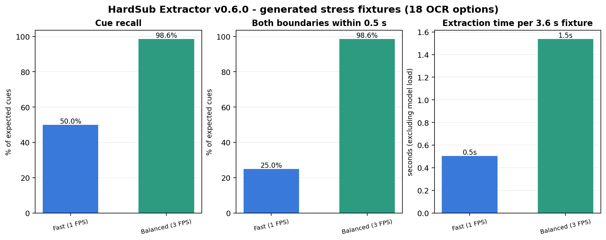
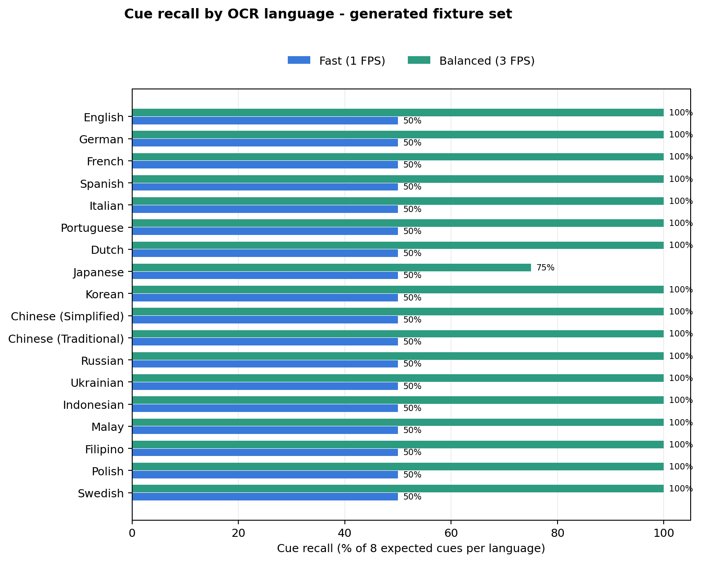

# HardSub Extractor v0.6.0 benchmark and process review

**App/source version:** `0.6.0` · **Modes:** Fast (1 FPS), Balanced (3 FPS) · **OCR options:** 18

**Run date:** 2026-11-16 · **Device selected:** GPU · **Hardware:** NVIDIA GeForce RTX 4070, driver 591.86

## Expanded fourteen-language master

The final second-benchmark report is tied to release `v0.6.0`: 14 of the 18 retained OCR choices, 1,400 successful runs, and overall findings and recommendations. Ukrainian, Malay, Polish, and Swedish are not covered. [Open the final master analysis](second-benchmark/MASTER_BENCHMARK_ANALYSIS.md).

## Second benchmark: five-language corpus

A follow-up run processed the curated 50-clip corpus for English, German, Italian, Spanish, and French through the v0.6.0 pipeline in Fast (1 FPS) and Balanced (3 FPS). All 500 runs completed. See the [second-run master analysis](second-five-language/MASTER_BENCHMARK_ANALYSIS.md) for pooled and per-language scores, timing, short-cue results, v0.5 comparison, findings, figures, and reproduction details. The original corpus media and run database remain excluded from this repository. This follow-up reuses the v0.5 inputs but changes both mode frame rates and pipeline behavior, so it is not an isolated pipeline A/B test.

The results below are a small generated-fixture diagnostic for the v0.6 pipeline. They do not rewrite the [v0.5.0 baseline](../v0.5.0/README.md), whose 23-language results and English 1/3/6 FPS experiment remain immutable. The paired 50-clip follow-up is documented separately above.

## Results

Each mode ran 36 cases: 18 OCR options, each on one clear and one moving/compressed/faded 3.6-second fixture. Each case contains four labeled cues, for 144 expected cues per mode and 8 per language.

| Measure | Fast (1 FPS) | Balanced (3 FPS) |
|---|---:|---:|
| Time-matched cues | 72/144 (50.0%) | 142/144 (98.6%) |
| Text-correct cues | 72/144 (50.0%) | 142/144 (98.6%) |
| Exact text among matched cues | 72/72 (100%) | 142/142 (100%) |
| Extra entries | 0 | 0 |
| Cue precision | 100% | 100% |
| Both boundaries within 0.5s of reference | 36/144 (25.0%) | 142/144 (98.6%) |
| Mean start error (matched cues only) | 0.450s | 0.055s |
| Mean end error (matched cues only) | 0.650s | 0.013s |
| Mean extraction time per 3.6s fixture | 0.495s | 1.549s |
| Mean sampled frames per fixture | 4 | 11 |
| Mean OCR calls per fixture | 4 | 9.5 |

Balanced detected 8/8 cues in 17 of the 18 languages. Japanese detected 6/8; both misses were in its two short stress cases. Fast detected 4/8 in every language. On this particular fixture set, the extra sampling and boundary checks in Balanced substantially improved cue capture and timing, at about 3.1 times the extraction time of Fast.





## Interpretation and limits

The synthetic cues include short 0.30-second and repeated identical lines. At 1 FPS, the sampler cannot observe many short transitions; where it sees the same line before and after a brief gap, it may represent the display as one cue. This makes Fast a speed-first mode with coarse timing. The 3 FPS mode handles these generated examples much better, including after reducing its blank-gap tolerance to avoid combining repeated cues across visible gaps.

No matched cue had a character error, and no extra entries occurred, but those results reflect legible generated fonts on two controlled backgrounds. This test used only two cases and eight cues per language; it does not validate real dialogue, varied fonts/codecs/resolutions, subtitle styles, or translation quality. It also cannot establish 95% real-video accuracy. No one-hour estimate is given for these very short fixtures.

Both ONNX sessions reported `CUDAExecutionProvider` with CPU fallback available. While the sweep was running, a single `nvidia-smi` sample showed 3% GPU utilization and 3,315 MiB used. ONNX Runtime also logged “No registered plugin EP device” for CUDA. Because the run did not trace provider usage per inference or continuously record utilization, these times are **not** a verified GPU-throughput claim.

## Benchmark design

The original 50-clip/language source set is represented by v0.5.0 metadata, but its 2.05 GB of generated video clips are absent from this workspace and Git. The earlier scripts need the original source clip to regenerate them. To provide a runnable v0.6 baseline, this release uses the fixture generator in [`benchmark_multilingual.py`](benchmark_multilingual.py): four cues in a clear clip and a moving/compressed/faded variant for every retained language. This corpus differs from v0.5.0 and is not numerically comparable with its 6,900 cues per mode.

Settings: OCR confidence 80%; subtitle-specific and centered filters on; white text filter; bottom subtitle region; GPU selected. Models were PaddleOCR 3.7.0 / PaddleX 3.7.2, ONNX Runtime GPU 1.30.0. The report records each case's model family, providers, output, extraction time, model initialization time, sample count, OCR calls, and cue boundaries.

## Files

- [`PROCESS_REVIEW.md`](PROCESS_REVIEW.md): earlier process problems, supporting evidence, fixes, and remaining recognizer limits.
- [`results/fast.json`](results/fast.json), [`results/balanced.json`](results/balanced.json): raw records for 36 cases per mode.
- [`results/summary.csv`](results/summary.csv): pooled mode metrics.
- [`results/per_language.csv`](results/per_language.csv): language-level results.
- [`results/mode_comparison.png`](results/mode_comparison.png), [`results/language_recall.png`](results/language_recall.png): figures.
- [`summarize_results.py`](summarize_results.py): regenerates the CSV summaries and figures (Python with matplotlib).

## Reproduction

From the repository root in the configured Windows environment:

```powershell
$env:PADDLE_PDX_CACHE_HOME = "..\.model-cache"
python tests\benchmark_multilingual.py --synthetic --stress --device gpu --mode Fast --report benchmarks\v0.6.0\results\fast.json
python tests\benchmark_multilingual.py --synthetic --stress --device gpu --mode Balanced --report benchmarks\v0.6.0\results\balanced.json
python benchmarks\v0.6.0\summarize_results.py
```

Use `--device cpu` for CPU inference. First use may download model files. A nonzero benchmark exit code means at least one 95% per-language quality gate was not met; the raw results are still written.
