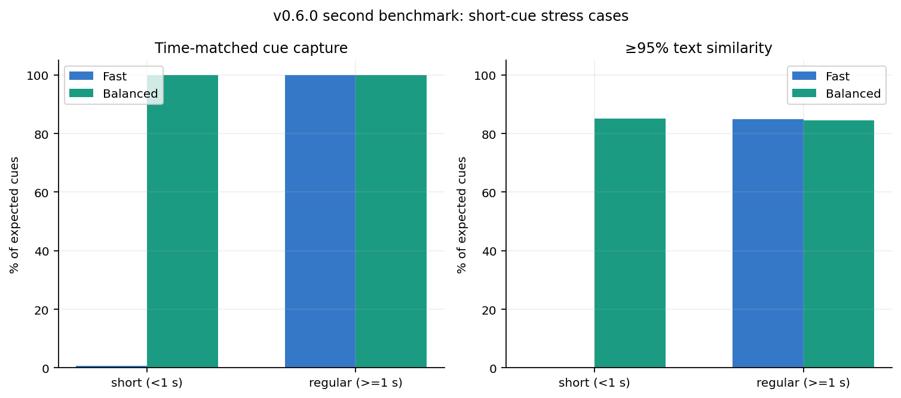

# HardSub Extractor v0.6.0 — second benchmark master analysis

**Scope:** English, German, Italian, Spanish, French, Chinese (Simplified), Chinese (Traditional), Japanese, Korean, Portuguese, Dutch, Russian, Indonesian, Filipino · **Modes:** Fast (1 FPS), Balanced (3 FPS) · **Benchmark date:** 2026-11-16
**Status:** Complete for the requested 14-language v0.6.0 benchmark scope. Controlled synthetic benchmark; these results do not establish accuracy on real-world dialogue.
**Historical pipeline snapshot:** v0.6.0; this report measures the earlier bundled extraction engine, not the standalone workflow script now in this repository.
**Coverage:** v0.6.0 offers 18 retained OCR language choices. This report tests 14; Ukrainian, Malay, Polish, and Swedish are not included.

## Executive summary

The same curated source clips and labels used for v0.5 were run through the v0.6.0 pipeline: 50 clips per language, six cues per clip, and 50 clips × 14 languages × 2 modes = 1400 extraction runs. All 1400 runs completed successfully, providing 4200 labeled cues per mode.
Across these 14 languages, Balanced had the higher time-matched cue capture. Balanced minus Fast was +3.3 percentage points. Balanced averaged 4.21× the Fast runtime per clip on this machine. Its strict exact full-line text was 3247/4200 (77.3%); punctuation-normalized exact text was 3712/4200 (88.4%), and exact letter/number content was 4177/4200 (99.45%). Read text quality, extras and timing alongside capture; synthetic text does not predict natural-dialogue accuracy.

## Pooled results

| Mode | Cues time-matched | Exact text in cue window | ≥95% matched text | Strict exact text | Punctuation-normalized exact text | Content characters exact in cue window | Extras | CER | Mean time / clip | Estimated min / hour | Both boundaries ≤0.1 s | Both boundaries ≤0.5 s |
|---|---:|---:|---:|---:|---:|---:|---:|---:|---:|---:|---:|---:|
| Fast (1 FPS) | 4061/4200 (96.7%) | 3189/4200 (75.9%) | 3446/4200 (82.0%) | 3133/4200 (74.6%) | 3633/4200 (86.5%) | 4075/4200 (97.02%) | 84.0 | 5.96% | 0.72 s | 2.3 | 0/4200 | 1/4200 |
| Balanced (3 FPS) | 4200/4200 (100.0%) | 3250/4200 (77.4%) | 3549/4200 (84.5%) | 3247/4200 (77.3%) | 3712/4200 (88.4%) | 4177/4200 (99.45%) | 148.0 | 3.84% | 3.02 s | 9.6 | 4126/4200 | 4148/4200 |

Timing-error summaries below are calculated only for matched cues; unmatched cues have no timing-error value. Both-boundary rates use all expected cues as denominator.

Median absolute start/end error was 0.667/0.400 seconds for Fast and 0.025/0.017 seconds for Balanced, calculated over time-matched cues only.

## Short-cue stress test

The corpus has 140 sub-second cues and 4060 regular cues across these 14 languages. Fast time-matched 1/140 short cues (0.7%) and 4060/4060 regular cues (100.0%). Balanced matched 140/140 short cues (100.0%) and 4060/4060 regular cues (100.0%). Fast's 1 FPS cadence missed nearly all of the short fixtures, while Balanced captured them all; this controlled set supports a strong sampling-cadence effect but does not imply every Fast text error has the same cause.

| Mode | Short cues ≥95% | Short strict exact | Regular cues ≥95% | Regular strict exact |
|---|---:|---:|---:|---:|
| Fast | 0/140 | 0/140 | 3446/4060 | 3133/4060 |
| Balanced | 119/140 | 114/140 | 3430/4060 | 3133/4060 |

## Findings and recommendation

- **Balanced is the stronger extraction mode for cue capture and timing in this test.** It captured 4200/4200 cues, reached 84.5% ≥95% similarity and 77.3% strict exact text, produced 148 extra entries, and placed both cue boundaries within 0.1 seconds for 4126/4200 expected cues.
- **Fast favors throughput over coverage and timing.** It ran about 4.21× faster by measured processing time, but captured 96.7% of cues, produced 84 unmatched entries, and no expected cue had both boundaries within 0.5 seconds.
- Fast captured only 1/140 sub-second cues (0.7%) while matching 4060/4060 regular cues. This indicates strong sensitivity to short-cue sampling at 1 FPS; it does not prove every Fast text error has the same cause.
- Fast produced 84 extra output entries; all 84 overlapped labeled cue windows and 0 were outside them. That pattern is consistent with fragments or duplicates around true cues, but overlap alone cannot establish why each extra occurred.
- Balanced produced 148 extra output entries; 148 overlapped labeled cue windows and 0 were outside them.
- Balanced had exact letter/number content in 7/14 languages (English, German, Spanish, French, Japanese, Dutch, Filipino). Strict exact text was below 95% in 7 languages (Spanish 85.0%, French 88.0%, Chinese (Simplified) 40.7%, Chinese (Traditional) 33.3%, Japanese 48.3%, Korean 36.7%, Russian 70.0%). Content-character exactness ignores case, punctuation, and spaces, so it diagnoses recognition separately from full-line fidelity but does not make those differences unimportant.
- Punctuation-normalized exact text exceeds strict exact by at least five points in 3 languages (Chinese (Simplified): strict 40.7%, punctuation-normalized 98.7%, Chinese (Traditional): strict 33.3%, punctuation-normalized 78.7%, Japanese: strict 48.3%, punctuation-normalized 98.3%). This helps identify punctuation/spacing-sensitive scores in scripts with differing punctuation conventions. The app still exports OCR's raw text; normalized scores do not rewrite it.
- Korean used a different OCR model family from the other tested languages (PP-OCRv5 server detector + Korean PP-OCRv5 mobile recognizer). Balanced matched 300/300 cues, with 36.7% strict exact, 37.7% punctuation-normalized exact, 95.0% content-character exact, and 128 unmatched output entries. Common punctuation normalization barely changes its score; the combination of low full-line fidelity and many in-cue extras points to spacing/output assembly or recognizer-specific issues that need review, but these metrics alone do not identify the cause.
- Portuguese and Dutch were strong in this controlled sample. Balanced strict exact text was 98.3% for Portuguese and 98.7% for Dutch; each captured 300/300 cues and had both boundaries within 0.1 seconds for 300/300 and 300/300 cues, with 0 and 1 unmatched entries, respectively.
- Indonesian and Filipino (the app's Filipino/Tagalog option) both performed strongly in this controlled set. Balanced strict exact text was 97.3% and 95.0%, respectively; each captured 300/300 cues. Both boundaries were within 0.1 seconds for 300/300 Indonesian cues and 299/300 Filipino cues. They produced 0 and 2 unmatched entries.
- Russian used PP-OCRv5 server detector + Eslav PP-OCRv5 mobile recognizer (ONNX Runtime). Balanced matched 300/300 cues and both boundaries were within 0.1 seconds for 296/300. Strict exact text was 70.0%, punctuation-normalized exact was 70.7%, and content-character exact was 99.0%. The character-only score is higher than full-line fidelity; it should not be read as full subtitle accuracy.
- Across Simplified Chinese, Traditional Chinese, Japanese and Korean, Balanced time-matched 1200/1200 cues versus 1161/1200 for Fast. Balanced strict exact text was 477/1200 (39.8%), punctuation-normalized exact was 940/1200 (78.3%), content characters were exact in 1183/1200 (98.6%), and both timing boundaries were within 0.1 seconds for 1131/1200 cues. Content-character scores ignore spaces and punctuation, so they are not full-line accuracy.
- Punctuation normalization raised Balanced exact-line scores sharply for Simplified Chinese (40.7% strict to 98.7% normalized) and Japanese (48.3% to 98.3%), and substantially for Traditional Chinese (33.3% to 78.7%). Korean changed only from 36.7% to 37.7%; combined with its 128 in-window unmatched entries, this language warrants separate recognition and line-assembly review.
- Estimated processing time was 2.3 minutes per video hour for Fast and 9.6 for Balanced. These short-clip projections are provisional because CUDA was selected but actual per-inference GPU placement was not verified.
- **Recommendation:** use Balanced when subtitle coverage and readable SRT timing matter, especially for dialogue with short cues. Treat Fast as a rapid preview mode for longer-lived subtitles; review its output before delivery. Neither mode has been validated to 95% on representative real footage.

## Results by language

| Language | Mode | Time capture | ≥95% text | Strict exact | Punctuation-normalized exact | Content chars exact in cue window | Extras | Clean clips (all six exact, no extras) | Mean time / clip | Estimated min / hour | Median start error | Median end error |
|---|---|---:|---:|---:|---:|---:|---:|---:|---:|---:|---:|---:|
| English | Fast | 96.7% | 96.7% | 94.3% | 288/300 (96.0%) | 293/300 (97.7%) | 4 | 33/50 | 0.73 s | 2.3 min | 0.667 s | 0.400 s |
| English | Balanced | 100.0% | 100.0% | 98.7% | 296/300 (98.7%) | 300/300 (100.0%) | 0 | 46/50 | 2.90 s | 9.2 min | 0.021 s | 0.017 s |
| German | Fast | 96.7% | 96.3% | 93.7% | 285/300 (95.0%) | 293/300 (97.7%) | 4 | 32/50 | 0.70 s | 2.2 min | 0.667 s | 0.400 s |
| German | Balanced | 100.0% | 100.0% | 96.7% | 290/300 (96.7%) | 300/300 (100.0%) | 0 | 40/50 | 2.93 s | 9.3 min | 0.021 s | 0.017 s |
| Italian | Fast | 96.7% | 96.0% | 89.3% | 274/300 (91.3%) | 292/300 (97.3%) | 4 | 25/50 | 0.70 s | 2.2 min | 0.667 s | 0.400 s |
| Italian | Balanced | 100.0% | 98.0% | 95.7% | 287/300 (95.7%) | 299/300 (99.7%) | 0 | 38/50 | 2.90 s | 9.2 min | 0.021 s | 0.017 s |
| Spanish | Fast | 96.7% | 95.0% | 81.3% | 248/300 (82.7%) | 293/300 (97.7%) | 4 | 5/50 | 0.74 s | 2.4 min | 0.667 s | 0.400 s |
| Spanish | Balanced | 100.0% | 98.7% | 85.0% | 255/300 (85.0%) | 300/300 (100.0%) | 0 | 7/50 | 3.12 s | 9.9 min | 0.021 s | 0.017 s |
| French | Fast | 96.7% | 94.7% | 86.0% | 265/300 (88.3%) | 293/300 (97.7%) | 4 | 16/50 | 0.71 s | 2.2 min | 0.667 s | 0.400 s |
| French | Balanced | 100.0% | 97.0% | 88.0% | 264/300 (88.0%) | 300/300 (100.0%) | 0 | 20/50 | 3.02 s | 9.6 min | 0.021 s | 0.017 s |
| Chinese (Simplified) | Fast | 96.7% | 50.0% | 43.0% | 290/300 (96.7%) | 292/300 (97.3%) | 5 | 1/50 | 0.71 s | 2.2 min | 0.667 s | 0.400 s |
| Chinese (Simplified) | Balanced | 100.0% | 48.7% | 40.7% | 296/300 (98.7%) | 299/300 (99.7%) | 5 | 0/50 | 2.94 s | 9.3 min | 0.025 s | 0.017 s |
| Chinese (Traditional) | Fast | 96.7% | 40.3% | 32.3% | 231/300 (77.0%) | 293/300 (97.7%) | 5 | 0/50 | 0.67 s | 2.1 min | 0.667 s | 0.400 s |
| Chinese (Traditional) | Balanced | 100.0% | 41.3% | 33.3% | 236/300 (78.7%) | 299/300 (99.7%) | 5 | 0/50 | 2.76 s | 8.7 min | 0.025 s | 0.017 s |
| Japanese | Fast | 96.7% | 61.0% | 45.7% | 288/300 (96.0%) | 292/300 (97.3%) | 5 | 0/50 | 0.74 s | 2.3 min | 0.667 s | 0.400 s |
| Japanese | Balanced | 100.0% | 64.0% | 48.3% | 295/300 (98.3%) | 300/300 (100.0%) | 2 | 0/50 | 3.03 s | 9.6 min | 0.025 s | 0.017 s |
| Korean | Fast | 97.0% | 44.7% | 37.0% | 114/300 (38.0%) | 273/300 (91.0%) | 28 | 0/50 | 0.71 s | 2.3 min | 0.667 s | 0.333 s |
| Korean | Balanced | 100.0% | 44.3% | 36.7% | 113/300 (37.7%) | 285/300 (95.0%) | 128 | 0/50 | 3.68 s | 11.7 min | 0.025 s | 0.017 s |
| Portuguese | Fast | 96.7% | 95.3% | 93.3% | 284/300 (94.7%) | 293/300 (97.7%) | 4 | 34/50 | 0.76 s | 2.4 min | 0.667 s | 0.400 s |
| Portuguese | Balanced | 100.0% | 99.7% | 98.3% | 295/300 (98.3%) | 299/300 (99.7%) | 0 | 46/50 | 3.09 s | 9.8 min | 0.021 s | 0.017 s |
| Dutch | Fast | 96.7% | 96.0% | 94.0% | 286/300 (95.3%) | 293/300 (97.7%) | 4 | 32/50 | 0.76 s | 2.4 min | 0.667 s | 0.400 s |
| Dutch | Balanced | 100.0% | 99.7% | 98.7% | 296/300 (98.7%) | 300/300 (100.0%) | 1 | 45/50 | 3.10 s | 9.8 min | 0.021 s | 0.017 s |
| Russian | Fast | 96.7% | 90.0% | 69.7% | 218/300 (72.7%) | 289/300 (96.3%) | 5 | 5/50 | 0.69 s | 2.2 min | 0.667 s | 0.400 s |
| Russian | Balanced | 100.0% | 92.0% | 70.0% | 212/300 (70.7%) | 297/300 (99.0%) | 5 | 8/50 | 2.94 s | 9.3 min | 0.025 s | 0.017 s |
| Indonesian | Fast | 96.7% | 96.7% | 94.0% | 286/300 (95.3%) | 293/300 (97.7%) | 4 | 34/50 | 0.73 s | 2.3 min | 0.667 s | 0.400 s |
| Indonesian | Balanced | 100.0% | 99.7% | 97.3% | 292/300 (97.3%) | 299/300 (99.7%) | 0 | 43/50 | 2.99 s | 9.5 min | 0.021 s | 0.017 s |
| Filipino | Fast | 96.7% | 96.0% | 90.7% | 276/300 (92.0%) | 293/300 (97.7%) | 4 | 27/50 | 0.71 s | 2.2 min | 0.667 s | 0.400 s |
| Filipino | Balanced | 100.0% | 100.0% | 95.0% | 285/300 (95.0%) | 300/300 (100.0%) | 2 | 36/50 | 2.93 s | 9.3 min | 0.021 s | 0.017 s |

## Comparison with v0.5.0

The v0.5.0 runs for these 14 languages used the same 50-clip language folders. The `index.csv` and `manifest.jsonl` in the current `Test-video/dataset` are byte-identical to the archived v0.5 metadata. The table compares the same labeled clips using the previous and current mode names:

| Language | Mode | v0.5 capture | v0.6 capture | Capture change | v0.5 exact | v0.6 exact | Exact change | v0.5 extras | v0.6 extras | v0.5 CER | v0.6 CER |
|---|---|---:|---:|---:|---:|---:|---:|---:|---:|---:|---:|
| English | Fast | 99.7% | 96.7% | -3.0 pp | 97.7% | 94.3% | -3.3 pp | 99 | 4 | 40.0% | 3.92% |
| English | Balanced | 99.7% | 100.0% | +0.3 pp | 97.0% | 98.7% | +1.7 pp | 159 | 0 | 63.5% | 0.05% |
| German | Fast | 99.3% | 96.7% | -2.7 pp | 98.7% | 93.7% | -5.0 pp | 113 | 4 | 40.9% | 4.36% |
| German | Balanced | 98.7% | 100.0% | +1.3 pp | 98.3% | 96.7% | -1.7 pp | 203 | 0 | 73.8% | 0.12% |
| Italian | Fast | 99.0% | 96.7% | -2.3 pp | 97.3% | 89.3% | -8.0 pp | 213 | 4 | 72.0% | 4.31% |
| Italian | Balanced | 98.0% | 100.0% | +2.0 pp | 96.3% | 95.7% | -0.7 pp | 357 | 0 | 121.9% | 0.19% |
| Spanish | Fast | 100.0% | 96.7% | -3.3 pp | 85.3% | 81.3% | -4.0 pp | 131 | 4 | 47.2% | 4.71% |
| Spanish | Balanced | 100.0% | 100.0% | +0.0 pp | 85.7% | 85.0% | -0.7 pp | 217 | 0 | 78.7% | 0.55% |
| French | Fast | 99.7% | 96.7% | -3.0 pp | 88.7% | 86.0% | -2.7 pp | 126 | 4 | 41.7% | 4.57% |
| French | Balanced | 99.3% | 100.0% | +0.7 pp | 88.0% | 88.0% | +0.0 pp | 225 | 0 | 76.1% | 0.50% |
| Chinese (Simplified) | Fast | 99.7% | 96.7% | -3.0 pp | 43.7% | 43.0% | -0.7 pp | 138 | 5 | 59.4% | 10.40% |
| Chinese (Simplified) | Balanced | 98.7% | 100.0% | +1.3 pp | 43.7% | 40.7% | -3.0 pp | 224 | 5 | 92.3% | 7.91% |
| Chinese (Traditional) | Fast | 100.0% | 96.7% | -3.3 pp | 34.7% | 32.3% | -2.3 pp | 23 | 5 | 18.7% | 15.05% |
| Chinese (Traditional) | Balanced | 100.0% | 100.0% | +0.0 pp | 34.0% | 33.3% | -0.7 pp | 39 | 5 | 22.5% | 12.34% |
| Japanese | Fast | 100.0% | 96.7% | -3.3 pp | 49.0% | 45.7% | -3.3 pp | 37 | 5 | 14.7% | 7.92% |
| Japanese | Balanced | 99.7% | 100.0% | +0.3 pp | 49.3% | 48.3% | -1.0 pp | 65 | 2 | 23.2% | 4.13% |
| Korean | Fast | 63.3% | 97.0% | +33.7 pp | 35.0% | 37.0% | +2.0 pp | 1889 | 28 | 644.1% | 17.82% |
| Korean | Balanced | 49.3% | 100.0% | +50.7 pp | 29.7% | 36.7% | +7.0 pp | 3282 | 128 | 1095.4% | 46.38% |
| Portuguese | Fast | 100.0% | 96.7% | -3.3 pp | 98.7% | 93.3% | -5.3 pp | 97 | 4 | 32.9% | 4.54% |
| Portuguese | Balanced | 99.3% | 100.0% | +0.7 pp | 98.3% | 98.3% | +0.0 pp | 212 | 0 | 71.7% | 0.09% |
| Dutch | Fast | 100.0% | 96.7% | -3.3 pp | 98.0% | 94.0% | -4.0 pp | 79 | 4 | 27.5% | 4.13% |
| Dutch | Balanced | 99.7% | 100.0% | +0.3 pp | 98.0% | 98.7% | +0.7 pp | 144 | 1 | 49.1% | 0.23% |
| Russian | Fast | 87.0% | 96.7% | +9.7 pp | 70.0% | 69.7% | -0.3 pp | 908 | 5 | 319.1% | 6.04% |
| Russian | Balanced | 79.7% | 100.0% | +20.3 pp | 67.0% | 70.0% | +3.0 pp | 1556 | 5 | 547.2% | 3.00% |
| Indonesian | Fast | 100.0% | 96.7% | -3.3 pp | 98.7% | 94.0% | -4.7 pp | 121 | 4 | 44.2% | 4.18% |
| Indonesian | Balanced | 99.3% | 100.0% | +0.7 pp | 97.7% | 97.3% | -0.3 pp | 215 | 0 | 79.6% | 0.10% |
| Filipino | Fast | 99.7% | 96.7% | -3.0 pp | 95.0% | 90.7% | -4.3 pp | 144 | 4 | 59.4% | 4.26% |
| Filipino | Balanced | 99.7% | 100.0% | +0.3 pp | 94.7% | 95.0% | +0.3 pp | 239 | 2 | 97.7% | 0.85% |

**This is not an isolated pipeline A/B test.** v0.6 changed the Fast target from 6 FPS to 1 FPS and Balanced from 8 FPS to 3 FPS; it also introduced the v0.6 pipeline adjustments. Thus, differences reflect sampling cadence, boundary refinement, cleanup and event grouping together. Do not attribute a change to one code change alone.

## v0.6 pipeline features under evaluation

- Timeline-based sampling targets the configured 1 or 3 FPS instead of converting a target cadence to an integer source-frame stride.
- Balanced performs targeted boundary refinement after the 3 FPS scan; Fast does not run that refinement.
- Script-aware event matching, confidence-weighted OCR readings, and spatially constrained short-gap cleanup reduce cue fragmentation.
- Script-aware comparisons support event stabilization and timing checks; OCR spelling remains unchanged in the exported subtitles.

The v0.5 per-language reports label the SHA-256 `521bdee29db5c6fb316170948697f9a952b443b01397beacf8259e020d15385f` as a source-file hash. It matches `hard_sub_extractor.py` at tag v0.5.0, not the source video. The source video hash recorded in the curated dataset and old run database is `280cb385b84657c8cd83c30184a3b3f2c9b0c5e3bc2b46db5a799a50026c7070`. This report records pipeline-code and input-video hashes separately. The v0.5 label was ambiguous; the generated clip index and manifest are unchanged.

## Benchmark setup

- App/source: v0.6.0; code SHA-256 `8d9bb3010092d24a9df5cf1826427446997fb72e53f25735384086cabfc0a503`.
- Input video: 320×240, 15 FPS, 18.93 seconds; SHA-256 `280cb385b84657c8cd83c30184a3b3f2c9b0c5e3bc2b46db5a799a50026c7070`.
- Dataset: 50 clips/language, six labeled cues/clip (300/language), source video hash above. All 14 selected language folders contain the expected MP4/JSON/SRT triplets.
- The benchmark runner calls the Python OCR backend and extraction pipeline directly; it does not exercise the packaged GUI/EXE, queue, subtitle editor, or export interactions.
- Dataset metadata identity checks: `index.csv` and `manifest.jsonl` are byte-identical to the archived v0.5 files. `source.json` has a location-only path difference; source hash, frame size, FPS, frame count, and duration match.
- Settings: minimum OCR confidence 80%; subtitle-specific and centered filters enabled; bottom 35% ROI; GPU selected; white-color filter for white cues and Any color for yellow/cyan cues.
- Hardware/software: NVIDIA GeForce RTX 4070, 12,282 MiB reported VRAM; NVIDIA driver 591.86; Python 3.12.3, PaddleOCR 3.7.0, PaddleX 3.7.2, ONNX Runtime GPU 1.30.0
- OCR model configurations: English: PP-OCRv6 medium detector + recognizer (ONNX Runtime); German: PP-OCRv6 medium detector + recognizer (ONNX Runtime); Italian: PP-OCRv6 medium detector + recognizer (ONNX Runtime); Spanish: PP-OCRv6 medium detector + recognizer (ONNX Runtime); French: PP-OCRv6 medium detector + recognizer (ONNX Runtime); Chinese (Simplified): PP-OCRv6 medium detector + recognizer (ONNX Runtime); Chinese (Traditional): PP-OCRv6 medium detector + recognizer (ONNX Runtime); Japanese: PP-OCRv6 medium detector + recognizer (ONNX Runtime); Korean: PP-OCRv5 server detector + Korean PP-OCRv5 mobile recognizer (ONNX Runtime); Portuguese: PP-OCRv6 medium detector + recognizer (ONNX Runtime); Dutch: PP-OCRv6 medium detector + recognizer (ONNX Runtime); Russian: PP-OCRv5 server detector + Eslav PP-OCRv5 mobile recognizer (ONNX Runtime); Indonesian: PP-OCRv6 medium detector + recognizer (ONNX Runtime); Filipino: PP-OCRv6 medium detector + recognizer (ONNX Runtime).
- Model initialization is excluded from per-clip extraction time. Linear one-hour projections are rough estimates from 18.93-second clips; they are not full-hour measurements.
- CUDAExecutionProvider and CPU fallback were listed for detector and recognizer in the ONNX sessions. ONNX Runtime also emitted a CUDA plugin-device warning; the benchmark did not trace every inference or continuously sample GPU utilization. Treat runtime and hour projections as provisional GPU-selected measurements.
- The source MP4s and SQLite database remain local and are not in this report folder. The output CSVs preserve per-run, per-cue and extra-entry metrics without embedding local absolute paths.

## How to read this benchmark

- Unless explicitly labeled as matched-only, cue scores use all expected cues as the denominator; a missed cue counts as incorrect. A time match requires at least 30% of a reference cue's duration to overlap one extracted entry. Each extracted entry and reference cue can match at most once.
- Strict exact and ≥95% similarity scores count punctuation and whitespace after NFC/whitespace normalization. Punctuation-normalized exact text maps common Chinese/ASCII punctuation equivalents and removes spaces for Chinese/Japanese; it is diagnostic only and does not rewrite SRT output. Exact text in cue window also counts an exact line found in any overlapping output, even if the one-to-one matcher chose another entry.
- Content-character exactness ignores case, whitespace, and punctuation. It measures letters/numbers in this rendered sample, not complete subtitle-line correctness.
- Extras are unmatched output entries. They may be cue fragments or false positives; overlap classification does not determine cause.
- CER counts edits in matched lines plus all characters from missed references and unmatched outputs; fragmentation can make it exceed intuitive character-recognition error.
- This dataset uses a single low-resolution moving background, a small hand-authored vocabulary, repeated phrases, rendered subtitles and limited combinations of style settings. It is useful for a paired regression check, not a representative real-video accuracy estimate or a 95% product guarantee.

## Final analysis and conclusion

This is the final v0.6.0 benchmark report for the 14-language suite requested. It is tied to release tag `v0.6.0` and source hash `8d9bb3010092d24a9df5cf1826427446997fb72e53f25735384086cabfc0a503`. Four retained app choices—Ukrainian, Malay, Polish, and Swedish—were not benchmarked, so the report makes no accuracy claim for them.

### What the mode comparison establishes

- **Balanced is the quality choice when cue coverage and timing matter.** It matched all 4,200 labeled cues, versus 4,061/4,200 (96.7%) for Fast. Both boundaries were within 0.1 seconds for 4,126/4,200 Balanced cues (98.2%); Fast reached that threshold for none. Balanced captured all 140 sub-second fixtures, while Fast captured only 1/140. All 4,060 regular cues were time-matched in both modes.
- **Fast is about 4.2× quicker in this run but has coarse timing.** The measured averages were 0.72 seconds per 18.93-second clip for Fast and 3.02 seconds for Balanced. Linear estimates are about 2.3 and 9.6 minutes per video hour, respectively. Model initialization is excluded, and CUDA inference was not verified, so these are provisional GPU-selected measurements.
- **Cue capture is not text correctness.** Balanced matched every cue, yet strict full-line text was exact for 77.3% overall and at least 95% in only 7 of 14 languages: English, German, Italian, Portuguese, Dutch, Indonesian, and Filipino (Tagalog). Its ≥95%-similar rate was 84.5%. A complete set of time matches therefore does not mean a clean or fully correct SRT.

### Language-specific reading

- Portuguese, Dutch, Indonesian, and Filipino (Tagalog) were strong on this controlled set, with Balanced strict exact text between 95.0% and 98.7%. English, German, and Italian also reached at least 95%. French (88.0%) and Spanish (85.0%) had high ≥95%-similar scores, but lower strict exact scores; review the exported text where punctuation or spelling must match precisely.
- Chinese and Japanese show a large difference between strict and punctuation-normalized scores: Simplified Chinese 40.7% vs 98.7%, Japanese 48.3% vs 98.3%, and Traditional Chinese 33.3% vs 78.7%. The normalizer maps punctuation variants and ignores spaces for Chinese/Japanese; it is a diagnostic score and does not alter SRT output.
- Korean remains a clear weak point: Balanced strict exact text was 36.7%, punctuation-normalized exact 37.7%, and content-character exact 95.0%. It also accounted for 128 of Balanced's 148 unmatched output entries. These entries overlapped labeled cue windows, which is consistent with fragments or duplicates but does not prove their cause. Korean needs separate review of recognition and event assembly.
- Russian had 70.0% strict exact text and 70.7% punctuation-normalized exact, while content characters were exact in 99.0% of cues. It uses a different PP-OCRv5 model pair. These scores indicate that high character-content recognition does not guarantee faithful full-line output; the benchmark does not isolate the source of the differences.

### Product conclusion

Use Balanced when producing an SRT that needs reliable cue coverage and timing. Fast suits a quick preview when speed matters more than short-cue coverage or precise boundaries. Review the SRT before delivery, with particular attention to Chinese, Japanese, Korean, Russian, Spanish, and French. Do not advertise a general 95% accuracy guarantee from this benchmark: it is a single low-resolution synthetic source with repeated phrases and limited visual variation, not a set of representative natural videos.

The next useful accuracy check is native-speaker review on varied real footage, using known subtitles and diverse resolutions, fonts, backgrounds, motion, and cue lengths. Test the packaged app and export workflow separately from this direct Python-backend benchmark, and record actual ONNX execution-provider use before publishing GPU speed claims. The v0.5-to-v0.6 comparison is not an isolated pipeline A/B test because both frame rates and pipeline behavior changed.

## Files

- `summary_by_mode.csv`: pooled mode metrics.
- `per_language.csv`: language-by-mode metrics.
- `duration_breakdown.csv`: short versus regular cue results.
- `v0.5_to_v0.6_comparison.csv`: same-corpus historical comparison.
- `dataset_hash_check.csv`: identity check against archived dataset metadata.
- `language_accuracy.png`, `mode_comparison.png`, `short_vs_regular.png`: statistical figures.
- `languages/`: detailed language reports, per-run and per-cue CSVs, style breakdowns and figures.
- [`../PROCESS_REVIEW.md`](../PROCESS_REVIEW.md): earlier benchmark-process problems and pipeline changes.
