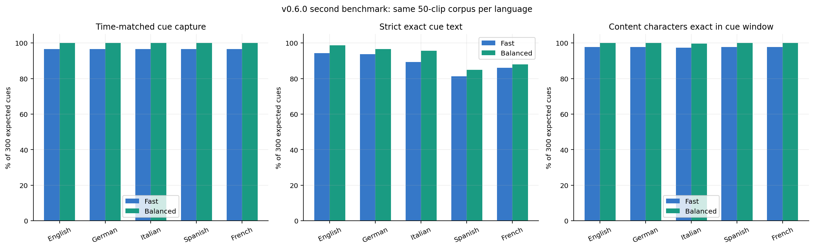
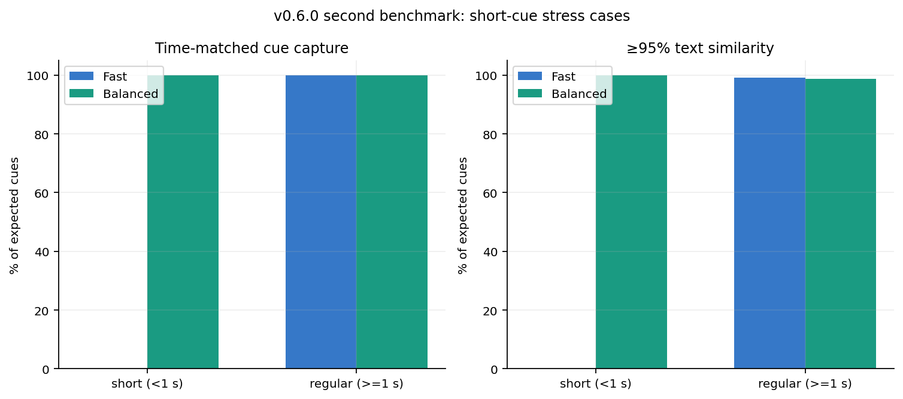

# HardSub Extractor v0.6.0 — second benchmark master analysis

**Scope:** English, German, Italian, Spanish, French · **Modes:** Fast (1 FPS), Balanced (3 FPS) · **Benchmark date:** 2026-11-16
**Status:** Controlled synthetic benchmark; these results do not establish accuracy on real-world dialogue.

> The complete 14-language second benchmark is documented in the [current master](../second-benchmark/MASTER_BENCHMARK_ANALYSIS.md) for the combined findings; this folder preserves the original five-language subset report.

## Executive summary

The same curated source clips and labels used for v0.5 were run through the v0.6.0 pipeline: 50 clips per language, six cues per clip, and 50 clips × 5 languages × 2 modes = 500 extraction runs. All 500 runs completed successfully, providing 1500 labeled cues per mode.
Across these 5 languages, Balanced had the higher time-matched cue capture. Balanced minus Fast was +3.3 percentage points. Balanced averaged 4.15× the Fast runtime per clip on this machine. Its character-only exact score in a cue window was 1499/1500 (99.93%); strict exact full-line text was 1392/1500 (92.8%). Read text quality, extras and timing alongside capture; synthetic text does not predict natural-dialogue accuracy.

## Pooled results

| Mode | Cues time-matched | Exact text in cue window | ≥95% matched text | Strict exact matched text | Content characters exact in cue window | Extras | CER | Mean time / clip | Estimated min / hour | Both boundaries ≤0.1 s | Both boundaries ≤0.5 s |
|---|---:|---:|---:|---:|---:|---:|---:|---:|---:|---:|---:|
| Fast (1 FPS) | 1450/1500 (96.7%) | 1354/1500 (90.3%) | 1436/1500 (95.7%) | 1334/1500 (88.9%) | 1464/1500 (97.60%) | 20.0 | 4.38% | 0.72 s | 2.3 | 0/1500 | 0/1500 |
| Balanced (3 FPS) | 1500/1500 (100.0%) | 1392/1500 (92.8%) | 1481/1500 (98.7%) | 1392/1500 (92.8%) | 1499/1500 (99.93%) | 0.0 | 0.29% | 2.97 s | 9.4 | 1500/1500 | 1500/1500 |

Timing-error summaries below are calculated only for matched cues; unmatched cues have no timing-error value. Both-boundary rates use all expected cues as denominator.

Median absolute start/end error was 0.667/0.400 seconds for Fast and 0.021/0.017 seconds for Balanced, calculated over time-matched cues only.

## Short-cue stress test

The corpus has 50 sub-second cues and 1450 regular cues across these 5 languages. Fast time-matched 0/50 short cues (0.0%) and 1450/1450 regular cues (100.0%). Balanced matched 50/50 short cues (100.0%) and 1450/1450 regular cues (100.0%). On these fixtures Fast missed every sub-second cue while matching every regular cue; that pattern points to the 1 FPS sampling interval as the cause of its misses in this test. Balanced's 3 FPS scan plus boundary refinement captured all short fixtures.

| Mode | Short cues ≥95% | Short strict exact | Regular cues ≥95% | Regular strict exact |
|---|---:|---:|---:|---:|
| Fast | 0/50 | 0/50 | 1436/1450 | 1334/1450 |
| Balanced | 50/50 | 49/50 | 1431/1450 | 1343/1450 |

## Findings and recommendation

- **Balanced is the stronger extraction mode in this test.** It captured 1500/1500 cues, reached 98.7% ≥95% similarity and 92.8% strict exact text, produced no extra entries, and placed both cue boundaries within 0.1 seconds for all 1500 expected cues.
- **Fast favors throughput over coverage and timing.** It ran about 4.15× faster by measured processing time, but captured 96.7% of cues, produced 20 unmatched entries, and no expected cue had both boundaries within 0.5 seconds.
- The decisive Fast failure pattern was duration-specific: all 50 sub-second cues were missed, while all 1,450 regular cues were matched. This strongly implicates the 1 FPS sampling interval for these short-cue misses; it does not prove every Fast text error has the same cause.
- Fast produced 20 extra output entries; all 20 overlapped labeled cue windows and 0 were outside them. That pattern is consistent with fragments or duplicates around true cues, but overlap alone cannot establish why each extra occurred.
- Balanced had exact letter/number content in 4/5 languages (English, German, Spanish, French). Strict exact text was below 95% in 2 languages (Spanish 85.0%, French 88.0%). Content-character exactness ignores case, punctuation, and spaces, so it diagnoses recognition separately from full-line fidelity but does not make those differences unimportant.
- Estimated processing time was 2.3 minutes per video hour for Fast and 9.4 for Balanced. These short-clip projections are provisional because CUDA was selected but actual per-inference GPU placement was not verified.
- **Recommendation:** use Balanced when subtitle coverage and readable SRT timing matter, especially for dialogue with short cues. Treat Fast as a rapid preview mode for longer-lived subtitles; review its output before delivery. Neither mode has been validated to 95% on representative real footage.

## Results by language

| Language | Mode | Time capture | ≥95% text | Strict exact | Content chars exact in cue window | Extras | Clean clips (all six exact, no extras) | Mean time / clip | Estimated min / hour | Median start error | Median end error |
|---|---|---:|---:|---:|---:|---:|---:|---:|---:|---:|---:|
| English | Fast | 96.7% | 96.7% | 94.3% | 293/300 (97.7%) | 4 | 33/50 | 0.73 s | 2.3 min | 0.667 s | 0.400 s |
| English | Balanced | 100.0% | 100.0% | 98.7% | 300/300 (100.0%) | 0 | 46/50 | 2.90 s | 9.2 min | 0.021 s | 0.017 s |
| German | Fast | 96.7% | 96.3% | 93.7% | 293/300 (97.7%) | 4 | 32/50 | 0.70 s | 2.2 min | 0.667 s | 0.400 s |
| German | Balanced | 100.0% | 100.0% | 96.7% | 300/300 (100.0%) | 0 | 40/50 | 2.93 s | 9.3 min | 0.021 s | 0.017 s |
| Italian | Fast | 96.7% | 96.0% | 89.3% | 292/300 (97.3%) | 4 | 25/50 | 0.70 s | 2.2 min | 0.667 s | 0.400 s |
| Italian | Balanced | 100.0% | 98.0% | 95.7% | 299/300 (99.7%) | 0 | 38/50 | 2.90 s | 9.2 min | 0.021 s | 0.017 s |
| Spanish | Fast | 96.7% | 95.0% | 81.3% | 293/300 (97.7%) | 4 | 5/50 | 0.74 s | 2.4 min | 0.667 s | 0.400 s |
| Spanish | Balanced | 100.0% | 98.7% | 85.0% | 300/300 (100.0%) | 0 | 7/50 | 3.12 s | 9.9 min | 0.021 s | 0.017 s |
| French | Fast | 96.7% | 94.7% | 86.0% | 293/300 (97.7%) | 4 | 16/50 | 0.71 s | 2.2 min | 0.667 s | 0.400 s |
| French | Balanced | 100.0% | 97.0% | 88.0% | 300/300 (100.0%) | 0 | 20/50 | 3.02 s | 9.6 min | 0.021 s | 0.017 s |

## Comparison with v0.5.0

The v0.5.0 runs for these 5 languages used the same 50-clip language folders. The `index.csv` and `manifest.jsonl` in the current `Test-video/dataset` are byte-identical to the archived v0.5 metadata. The table compares the same labeled clips using the previous and current mode names:

| Language | Mode | v0.5 capture | v0.6 capture | Capture change | v0.5 exact | v0.6 exact | Exact change | v0.5 extras | v0.6 extras | v0.5 CER | v0.6 CER |
|---|---|---:|---:|---:|---:|---:|---:|---:|---:|---:|---:|
| English | Fast | 99.7% | 96.7% | -3.0 pp | 97.7% | 94.3% | -3.3 pp | 99 | 4 | 40.0% | 3.92% |
| English | Balanced | 99.7% | 100.0% | +0.3 pp | 97.0% | 98.7% | +1.7 pp | 159 | 0 | 63.5% | 0.05% |
| German | Fast | 99.3% | 96.7% | -2.7 pp | 98.7% | 93.7% | -5.0 pp | 113 | 4 | 40.9% | 4.36% |
| German | Balanced | 98.7% | 100.0% | +1.3 pp | 98.3% | 96.7% | -1.7 pp | 203 | 0 | 73.8% | 0.12% |
| Italian | Fast | 99.0% | 96.7% | -2.3 pp | 97.3% | 89.3% | -8.0 pp | 213 | 4 | 72.0% | 4.31% |
| Italian | Balanced | 98.0% | 100.0% | +2.0 pp | 96.3% | 95.7% | -0.7 pp | 357 | 0 | 121.9% | 0.19% |
| Spanish | Fast | 100.0% | 96.7% | -3.3 pp | 85.3% | 81.3% | -4.0 pp | 131 | 4 | 47.2% | 4.71% |
| Spanish | Balanced | 100.0% | 100.0% | +0.0 pp | 85.7% | 85.0% | -0.7 pp | 217 | 0 | 78.7% | 0.55% |
| French | Fast | 99.7% | 96.7% | -3.0 pp | 88.7% | 86.0% | -2.7 pp | 126 | 4 | 41.7% | 4.57% |
| French | Balanced | 99.3% | 100.0% | +0.7 pp | 88.0% | 88.0% | +0.0 pp | 225 | 0 | 76.1% | 0.50% |

**This is not an isolated pipeline A/B test.** v0.6 changed the Fast target from 6 FPS to 1 FPS and Balanced from 8 FPS to 3 FPS; it also introduced the v0.6 pipeline adjustments. Thus, differences reflect sampling cadence, boundary refinement, cleanup and event grouping together. Do not attribute a change to one code change alone.

## v0.6 pipeline features under evaluation

- Timeline-based sampling targets the configured 1 or 3 FPS instead of converting a target cadence to an integer source-frame stride.
- Balanced performs targeted boundary refinement after the 3 FPS scan; Fast does not run that refinement.
- Script-aware event matching, confidence-weighted OCR readings, and spatially constrained short-gap cleanup reduce cue fragmentation.
- Script-aware comparisons support event stabilization and timing checks; OCR spelling remains unchanged in the exported subtitles.

The v0.5 per-language reports label the SHA-256 `521bdee29db5c6fb316170948697f9a952b443b01397beacf8259e020d15385f` as a source-file hash. It matches `hard_sub_extractor.py` at tag v0.5.0, not the source video. The source video hash recorded in the curated dataset and old run database is `280cb385b84657c8cd83c30184a3b3f2c9b0c5e3bc2b46db5a799a50026c7070`. This report records pipeline-code and input-video hashes separately. The v0.5 label was ambiguous; the generated clip index and manifest are unchanged.

## Benchmark setup

- App/source: v0.6.0; code SHA-256 `8d9bb3010092d24a9df5cf1826427446997fb72e53f25735384086cabfc0a503`.
- Input video: 320×240, 15 FPS, 18.93 seconds; SHA-256 `280cb385b84657c8cd83c30184a3b3f2c9b0c5e3bc2b46db5a799a50026c7070`.
- Dataset: 50 clips/language, six labeled cues/clip (300/language), source video hash above. All 5 selected language folders contain the expected MP4/JSON/SRT triplets.
- Dataset metadata identity checks: `index.csv` and `manifest.jsonl` are byte-identical to the archived v0.5 files. `source.json` has a location-only path difference; source hash, frame size, FPS, frame count, and duration match.
- Settings: minimum OCR confidence 80%; subtitle-specific and centered filters enabled; bottom 35% ROI; GPU selected; white-color filter for white cues and Any color for yellow/cyan cues.
- Hardware/software: NVIDIA GeForce RTX 4070, 12,282 MiB reported VRAM; NVIDIA driver 591.86; Python 3.12.3, PaddleOCR 3.7.0, PaddleX 3.7.2, ONNX Runtime GPU 1.30.0
- Model initialization is excluded from per-clip extraction time. Linear one-hour projections are rough estimates from 18.93-second clips; they are not full-hour measurements.
- CUDAExecutionProvider and CPU fallback were listed for detector and recognizer in the ONNX sessions. ONNX Runtime also emitted a CUDA plugin-device warning; the benchmark did not trace every inference or continuously sample GPU utilization. Treat runtime and hour projections as provisional GPU-selected measurements.
- The source MP4s and SQLite database remain local and are not in this report folder. The output CSVs preserve per-run, per-cue and extra-entry metrics without embedding local absolute paths.

## How to read this benchmark

- Unless explicitly labeled as matched-only, cue scores use all expected cues as the denominator; a missed cue counts as incorrect. A time match requires at least 30% of a reference cue's duration to overlap one extracted entry. Each extracted entry and reference cue can match at most once.
- Strict exact and ≥95% scores count punctuation and whitespace after NFC/whitespace normalization. Exact text in cue window also counts an exact line found in any overlapping output, even if the one-to-one matcher chose another entry.
- Content-character exactness ignores case, whitespace, and punctuation. It measures letters/numbers in this rendered sample, not complete subtitle-line correctness.
- Extras are unmatched output entries. They may be cue fragments or false positives; overlap classification does not determine cause.
- CER counts edits in matched lines plus all characters from missed references and unmatched outputs; fragmentation can make it exceed intuitive character-recognition error.
- This dataset uses a single low-resolution moving background, a small hand-authored vocabulary, repeated phrases, rendered subtitles and limited combinations of style settings. It is useful for a paired regression check, not a representative real-video accuracy estimate or a 95% product guarantee.

## Files

- `summary_by_mode.csv`: pooled mode metrics.
- `per_language.csv`: language-by-mode metrics.
- `duration_breakdown.csv`: short versus regular cue results.
- `v0.5_to_v0.6_comparison.csv`: same-corpus historical comparison.
- `dataset_hash_check.csv`: identity check against archived dataset metadata.
- `language_accuracy.png`, `mode_comparison.png`, `short_vs_regular.png`: statistical figures.
- `languages/`: detailed language reports, per-run and per-cue CSVs, style breakdowns and figures.
- [`../PROCESS_REVIEW.md`](../PROCESS_REVIEW.md): earlier benchmark-process problems and pipeline changes.
