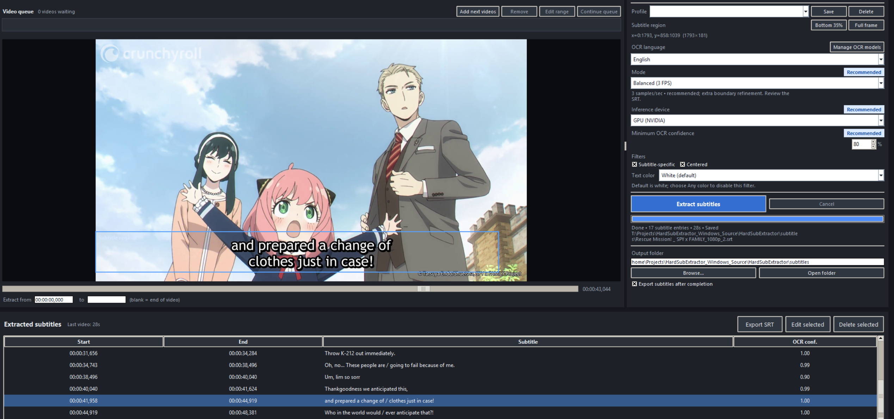
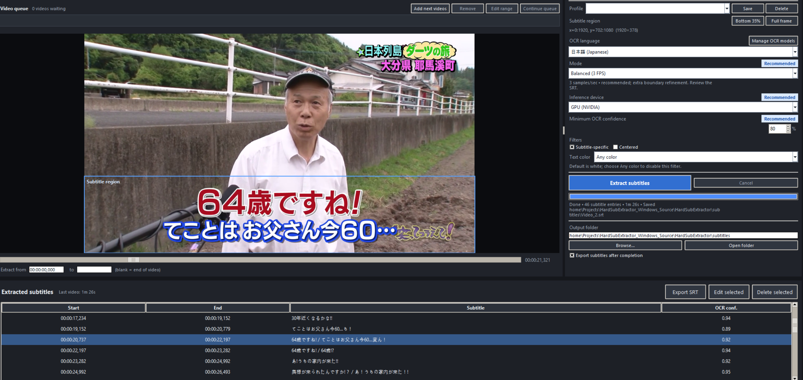

# App screenshots

These two screenshots show subtitle extraction in the desktop app using short English and Japanese sample videos.

## English sample

English is selected with Balanced mode, NVIDIA inference, 80% confidence, and centered white-text filters. The preview and completed cue list are visible.

## Japanese sample

Japanese is selected with Balanced mode and NVIDIA inference. The subtitle region and OCR results appear alongside the video preview.

The screenshots are included for demonstration. The video files are not included in this repository.
